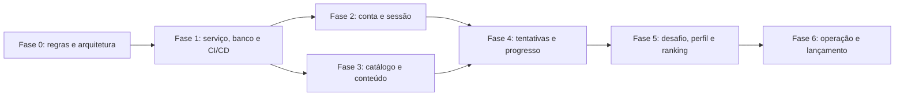

# Nublue — Plano de implementação do backend

> **Status em 11/11/2026:** implementação local na branch `codex/backend-course-plan`. Use `[x]` para código entregue localmente, `[~]` para parcial/pendente de validação e `[ ]` para trabalho futuro. Nenhuma migração foi aplicada em PlanetScale; testes/build não foram executados.

**Objetivo:** substituir as regras e os dados locais do protótipo por uma API e persistência compartilhada, preservando a interface React/Vite existente.

**Arquitetura implementada localmente:** manter React/Vite e adicionar uma API HTTP independente em Node.js (JavaScript ESM), com PostgreSQL PlanetScale, autenticação e validação de atividades no servidor. O framework HTTP é o servidor nativo do Node; o banco usa `pg`.

**Tecnologias:** frontend React/TypeScript/Vite; API Node.js 20.6+/JavaScript; banco PlanetScale Postgres. URLs de conexão e provisionamento ainda precisam ser configurados no ambiente de execução.

**Contexto usado:** auditoria do repositório em 11/11/2026; `Nublue - Backlog.md`, `Nublue, funcionamento antigo e novo.md` e `planejamento_curso_cruzadinhas_matematicas.md`; imagem de referência enviada para calibrar `very_hard`.

## Restrições globais

- Preservar React/Vite; migração de frontend depende de uma decisão registrada na Fase 0.
- O gabarito, a validação, a conclusão e a concessão de XP pertencem ao servidor.
- Segredos de runtime não podem entrar no código do frontend nem no repositório.
- Dados e visibilidade de estudantes menores precisam seguir as decisões de privacidade aprovadas antes de produção.

### Estrutura implementada

```text
backend/
  src/server.js                 # Inicialização e encerramento do serviço
  src/config/env.js             # Validação de configuração de runtime
  src/db/migrations/            # Histórico SQL do schema
  src/db/seed-course.js         # Seed versionado do catálogo
  src/app.js                    # Rotas de autenticação, jogo e progresso
  src/data/course-catalog.json  # Conteúdo/gabarito mantido no backend
```

O trabalho está no worktree `/home/breno/.codex/worktrees/backend-course-plan/NuBlue`. A documentação operacional local está em `backend/README.md`.

## Resumo do estado atual

Não foi encontrado backend, schema de banco, migração, endpoint ou chamada HTTP da aplicação. O `package.json` só oferece `dev` e `build`; não há script de testes. O workflow `.github/workflows/ci.yml` instala dependências e executa o build do frontend.

| Área | Situação no repositório | O que isso significa para o backend |
|---|---|---|
| Landing page | Implementada em `src/app/features/landing/LandingPage.tsx` | A interface pública existe; cadastro e login reais continuam pendentes. |
| Login e cadastro | Modal e campos existem em `AuthDialog.tsx`; o submit não envia email ou senha para um serviço. Login apenas abre o app; cadastro guarda o nome localmente e inicia o diagnóstico. | Implementar contas, sessão, recuperação e integração com a interface. |
| Diagnóstico | `DiagnosticTest.tsx` apresenta seis cruzadinhas e retorna uma dificuldade ao fluxo local; resultado não é associado a uma conta. | Decidir se a dificuldade/resultados serão persistidos no perfil e em que nível de detalhe. |
| Jogo e conteúdo | Mecânicas jogáveis e 15 níveis estáticos em `src/app/data/levels.ts`, distribuídos por cinco capítulos. | Migrar conteúdo para catálogo validado e manter gabaritos no servidor. |
| Trilha | `SkillPathTab.tsx` calcula bloqueio no cliente: cada capítulo libera o primeiro nível e os seguintes dependem do anterior naquele capítulo. | Definir pré-requisitos e devolver estado de desbloqueio a partir do progresso persistido. |
| Progresso e XP | `useGameController.ts` confere respostas e atualiza XP no navegador; progresso é salvo em `localStorage`. O código mantém uma sequência de atividade e outra de desafios diários. | Servidor deve validar, registrar e conceder XP sem confiar no cliente; formalizar as duas regras ou consolidá-las. |
| Desafio diário | Gerado no cliente; progresso do jogo e da landing page usa chaves locais separadas. A data é baseada no fuso local do navegador; o desafio da landing não atualiza o XP do perfil. | Unificar regra, identidade do desafio, persistência e definição do dia no servidor. |
| Perfil e conquistas | Nome, estatísticas e conquistas são montados a partir de estado local em `App.tsx` e `ProfileTab.tsx`. | Vincular a uma conta e calcular/carregar dados persistidos. |
| Ranking | `RankingTab.tsx` combina `MOCK_PLAYERS` com XP local. O XP semanal do próprio usuário também usa o valor total. | Remover dados fictícios e definir períodos, desempates e exibição segura de apelidos. |
| CI e publicação | CI executa build; não há etapa de testes ou CD no workflow encontrado. | Integrar build/testes/migrações e planejar homologação, produção, health check e rollback. |

### O que já está concluído no frontend

- Estrutura por funcionalidades para jogo, aprendizagem, desafios, perfil, ranking e navegação.
- Landing page, diálogo visual de cadastro/login, teste diagnóstico, trilha, jogo, desafio, perfil e ranking.
- Quinze níveis de exemplo e gerador determinístico de desafios no cliente.
- Salvamento local de progresso e algumas preferências; isso é persistência de protótipo, não uma conta nem sincronização entre dispositivos.
- CI de build para o frontend.

### O que ainda não está concluído

Na auditoria inicial, nenhuma funcionalidade de backend estava implementada. O estado depois da implementação está detalhado nas fases abaixo. Continuam pendentes validação de execução, CI/CD do backend, provisionamento/configuração do banco remoto, política final de privacidade infantil, recuperação de conta e operação de produção.

## Reconciliação dos documentos de contexto

Os textos enviados refletem mais de um momento do projeto e não coincidem integralmente com o código atual. Este plano usa o código como fonte de status: há uma landing page e `localStorage`; há 15 níveis nos cinco capítulos, não somente três níveis jogáveis e dois bloqueios de exemplo. Cadastro/login estão “feitos” apenas como interface, sem autenticação. A organização por funcionalidades e tokens de tema descrita como aplicada está presente no repositório.

O README antigo cita Next.js/Node/PostgreSQL (com grafia incorreta “PostgreeDB”), enquanto o frontend executa com Vite. A proposta Express + PostgreSQL nos documentos era sugestão. Para esta implementação, o usuário selecionou PlanetScale Postgres; foi adotado Node.js com `pg`, sem migrar o frontend para Next.js nem introduzir Express.

## Abordagens consideradas

| Opção | Vantagem | Custo e risco | Situação |
|---|---|---|---|
| API REST independente mantendo o Vite | Preserva a interface existente e separa o ciclo de publicação do backend. Node/TypeScript + PostgreSQL é a candidata mais alinhada ao backlog. | Exige operar e proteger um serviço e um banco além do frontend. | **Recomendação provisória**; registrar decisão e hospedagem na Fase 0. |
| Migrar o frontend para Next.js e hospedar API junto | Pode concentrar frontend e rotas de servidor em uma aplicação. | Migração de uma SPA Vite existente, custo de mudança e deploy; não há requisito identificado que exija a migração. | Comparar na Fase 0; não iniciar sem justificativa concreta. |
| Backend gerenciado com autenticação e banco | Pode reduzir infraestrutura própria inicial. | Regras de respostas, XP, sessões diárias e privacidade ainda precisam de execução confiável no servidor; dependência de plataforma. | Comparar na Fase 0, sem escolher fornecedor antecipadamente. |

## Decisões necessárias antes da implementação

1. **Escopo/conta:** decidido para esta implementação: conta direta do estudante por apelido e senha, sem email. Revisão de privacidade/consentimento infantil continua pendente para produção.
2. **Privacidade:** ranking começa desligado e só exibe apelido após opt-in. Exclusão está exposta via API; política de retenção e revisão infantil continuam pendentes.
3. **Regras de aprendizagem:** primeira conclusão correta concede XP; repetição não concede novamente. Reenvio HTTP usa chave idempotente; nova tentativa intencional recebe nova chave. Níveis destravam em sequência dentro do capítulo.
4. **Calendário:** desafio diário usa dia UTC; ranking semanal usa semana UTC iniciada na segunda-feira. A virada encerra a execução diária anterior.
5. **Landing:** desafio público continua demonstração anônima, local e sem recompensa na conta; desafio autenticado tem estado persistido no backend.
6. **Dados do navegador:** progresso legado não é importado para conta; permanece no dispositivo para o modo local.
7. **Conteúdo/administração:** curso é JSON versionado com seed; CMS não está no escopo desta implementação. Os 39 níveis vêm do planejamento do curso.
8. **Stack/recuperação:** PlanetScale Postgres + `pg`, API Node.js separada. Não há recuperação de senha; hospedagem/segredos/deploy ainda precisam ser definidos.
9. **Diagnóstico:** resultado continua local e não é sincronizado ao perfil nesta versão.

**Entrega da Fase 0:** parcialmente concluída pelas decisões acima e pelo ledger `.superpowers/sdd/2026-11-11-backend-implementation-plan/progress.md`. Ainda falta registrar critérios completos de aceite, hospedagem/operação e matriz de dados aprovada para público infantil.

## Modelo de domínio inicial

O schema inicial existe em `backend/src/db/migrations/001_initial_schema.sql`. Ele cobre:

- **Conta e sessão:** `students` guarda apelido, chave normalizada, hash e opt-in; `student_sessions` guarda somente hash do token.
- **Catálogo e gabarito:** `course_levels` separa `public_data` de `answer_key` e marca o bônus.
- **Tentativa, conclusão e XP:** `level_attempts`, `level_completions` e `xp_events` usam transações e chaves únicas para idempotência.
- **Progresso:** `student_progress` guarda agregados de perfil e streaks.
- **Desafio diário:** `daily_challenge_runs` e `daily_challenge_attempts` persistem estado, rascunho, coração e tentativa.
- **Pendente:** editor administrativo, persistência da dificuldade do diagnóstico e domínio de conquistas no servidor.

### Contratos HTTP candidatos

Rotas atualmente implementadas no serviço. Todas usam o prefixo `/api`:

| Rota | Uso |
|---|---|
| `GET /api/health`, `GET /api/catalog` | Saúde do serviço e catálogo público sem gabarito. |
| `POST /api/auth/register`, `/api/auth/login`, `/api/auth/logout` | Conta por apelido/senha e sessão em cookie HTTP-only; recuperação não existe. |
| `GET /api/me`, `/api/progress`, `/api/profile`, `DELETE /api/me` | Identidade, progresso e exclusão da conta autenticada. |
| `POST /api/attempts` | Corrigir tentativa e registrar conclusão/XP no servidor. |
| `GET /api/daily-challenge`, `POST /api/daily-challenge/draft`, `/api/daily-challenge/attempt` | Desafio persistido, rascunho e submissão idempotente. |
| `PATCH /api/me/leaderboard-visibility`, `GET /api/leaderboard?period=weekly\|all` | Opt-in de visibilidade e ranking semanal/geral. |
| `GET /api/catalog/bonus/very-hard` | Bônus disponível após concluir os 39 níveis. |

**Regra de confiança:** o cliente não envia um XP confiável, status de conclusão ou resultado final. O servidor calcula esses valores, autoriza cada conta sobre seus próprios dados e responde sem revelar chaves de resposta.

## Plano por fases

### Fase 0 — Fechar requisitos e arquitetura

- [~] Consolidar casos de uso: conta direta de estudante por apelido/senha; papel de responsável e administrador/editor não foram implementados.
- [~] Definir conta e dados mínimos para a implementação; revisão de privacidade infantil e consentimento antes de produção continuam pendentes.
- [x] Registrar XP por primeira conclusão, repetição, sequência UTC, ranking opt-in, desafio diário UTC e pré-requisitos por capítulo.
- [x] Decidir não importar progresso local para conta.
- [~] Escolher PlanetScale Postgres e API Node.js separada; hospedagem, ambientes e gestão de segredos ainda sem ADR operacional.
- [~] Usar os 39 níveis do plano do curso e o quebra-cabeça da imagem como bônus; critérios completos de aceite e revisão pedagógica ainda pendentes.
- [x] Manter o resultado do diagnóstico local nesta versão.

**Aceite:** parcial. Regras suficientes para a implementação local foram registradas; revisão de privacidade, ambiente/deploy e matriz de dados ainda bloqueiam produção.

### Fase 1 — Fundação do serviço, banco e entrega

- [x] Criar a estrutura do backend, configuração por ambiente e endpoint de saúde.
- [x] Escrever migrações ordenadas com tabela de controle e advisory lock; ainda não foram aplicadas a um banco PostgreSQL.
- [x] Documentar fluxo local frontend/API/banco e variáveis sem incluir credenciais.
- [ ] Expandir CI para instalar/buildar frontend e backend e executar verificações automatizadas do backend.
- [ ] Configurar deploy de homologação, variáveis secretas no ambiente de execução, verificação de saúde e rollback.
- [~] Definir conexão direta para migrações e pool transacional para API; automatizar e validar migrações durante deploy continua pendente.

**Aceite:** parcial. Código e instruções estão presentes, mas não houve execução contra um banco limpo, CI do backend ou publicação de homologação.

### Fase 2 — Conta, sessão e perfil

- [x] Implementar cadastro, login e logout por apelido e senha.
- [x] Não oferecer recuperação por email, conforme a decisão registrada; não há formulário de recuperação.
- [~] Hash scrypt, validação e rate limit em memória estão implementados; rate limit compartilhado para múltiplas instâncias ainda falta.
- [x] Proteger rotas de perfil/progresso e associar dados à sessão da conta.
- [~] API permite exclusão definitiva da conta; falta ação de exclusão na interface e revisão da política de retenção.
- [x] Substituir callbacks simulados do `AuthDialog.tsx` por chamadas via `src/app/api/client.ts`.
- [x] Carregar identidade pelo backend e usar cookie de sessão HTTP-only.
- [x] Manter o resultado do diagnóstico apenas local.
- [~] Formulário trata erros de autenticação e rede; recuperação de sessão expirada/aviso de carregamento inicial ainda precisa de acabamento.

**Aceite:** implementação local entregue, sem validação de execução. Sessão persistente, isolamento entre contas, exclusão por interface e recuperação de sessão expirada precisam ser verificados/concluídos.

### Fase 3 — Catálogo e conteúdo protegido

- [~] Representar curso/unidade/lição/grade e resposta como JSON versionado mais colunas no PostgreSQL; validador formal de schema ainda falta.
- [x] Gerar catálogo versionado dos 39 níveis e cinco capítulos a partir do planejamento fornecido; o importador verifica os resultados das equações fonte.
- [~] Preservar instruções e equações planejadas; revisão pedagógica e organização visual cruzada de cada nível ainda faltam. As equações ponte geradas são adicionais.
- [x] Seed separa `public_data` de `answer_key`; endpoints públicos não retornam gabaritos.
- [~] API serve catálogo e bloqueia submissões fora da sequência do capítulo; não envia um mapa de desbloqueio individual no payload do catálogo.
- [~] Interface consome catálogo quando disponível; `LEVELS` permanece como fallback local, enquanto perfil usa o total vindo do catálogo.
- [x] Atualizar a trilha para capítulos, unidades e níveis servidos pela API.
- [x] Escolher seed versionado para o MVP; CMS não foi incluído.

**Aceite:** parcial. Catálogo e separação de respostas estão implementados; schema/qualidade do conteúdo e apresentação visual dos 39 níveis precisam de revisão, sem executar validação nesta entrega.

### Fase 4 — Tentativas, XP e progresso persistente

- [x] Implementar envio/correção no servidor para níveis e bônus.
- [x] Registrar tentativas, conclusões e eventos de XP em transação; chaves idempotentes protegem reenvios.
- [x] Uma nova tentativa usa nova chave, mas XP de nível só é concedido na primeira conclusão correta.
- [~] Validar corpo, respostas e tamanho; rate limit específico para tentativas de jogo ainda falta.
- [x] Persistir conclusão, XP, streak e resumo de progresso.
- [x] Calcular streaks e datas de desafio em UTC.
- [x] Integrar `useGameController.ts` ao endpoint; a API é fonte de verdade para conta autenticada e o jogo local continua para visitantes.
- [~] Desbloqueio é refletido pelas conclusões recebidas, com regra local da trilha e bloqueio de tentativa no servidor; falta endpoint dedicado de disponibilidade.
- [x] Não importar progresso legado para contas; fluxo local continua separado.

**Aceite:** implementação local entregue; idempotência, progresso multi-dispositivo e falha de API ainda não foram executados/verificados.

### Fase 5 — Desafio diário, perfil, conquistas e ranking

- [~] Definir duas experiências: landing anônima sem recompensa e desafio autenticado persistente; a landing não é sincronizada à conta.
- [x] Persistir estado, rascunho, tentativas e XP do desafio autenticado; usar chave idempotente e data UTC.
- [~] Perfil usa métricas persistidas; critérios visuais de conquistas ainda são derivados no frontend.
- [x] Remover o arquivo de jogadores fictícios; ranking semanal/geral vem de eventos de XP e só lista opt-ins.
- [x] Conectar telas de perfil, ranking e desafio aos dados disponíveis na API; fluxo anônimo da landing permanece local por decisão.

**Aceite:** implementação local entregue; ranking semanal usa eventos da semana UTC, e participação é explícita. Critérios de conquistas permanecem no cliente e precisam ser decididos se houver necessidade de domínio server-side.

### Fase 6 — Conteúdo, segurança e operação de lançamento

- [x] Documentar processo de seed/versionamento; ferramenta administrativa continua fora do MVP desta implementação.
- [~] API tem autorização, validação de payload e logs genéricos; revisão de segurança completa e rate limiting distribuído ainda faltam.
- [ ] Definir backup, retenção e procedimento testável de restauração do banco.
- [ ] Fazer revisão apropriada de privacidade para público infantil antes de produção.
- [~] Há estados de erro/carregamento em telas integradas; revisão de acessibilidade e estados de sessão expirável ainda pendentes.
- [ ] Completar CD com promoção para produção, verificação pós-deploy e rollback.

**Aceite:** não atendido. A branch ainda não está pronta para lançamento: faltam operações, revisão de privacidade, backup/restore, CI/CD e verificações automatizadas.

## Ordem e dependências



A landing page pode continuar evoluindo em paralelo, mas só deve anunciar cadastro/login como funcionais depois da integração da Fase 2. A fundação de CI/CD começa junto da API para que migrações e verificações não sejam adicionadas apenas no fim.

## Revisão de risco: casos que precisam de cobertura

1. **XP ou resposta adulterados no cliente:** servidor ignora totais enviados; testes da Fase 4 verificam cálculo e concessão do lado servidor.
2. **Reenvio após timeout ou clique repetido:** tentativas idempotentes; testes da Fase 4 confirmam uma única recompensa.
3. **Acesso cruzado entre contas:** autorização por proprietário; testes da Fase 2 tentam ler e alterar dados de outra conta.
4. **Mudança de data e fuso:** regra diária é calculada no servidor; testes da Fase 4/5 cobrem meia-noite, dia anterior e sessão retomada.
5. **Conteúdo inválido ou gabarito exposto:** o importador confere as respostas do planejamento e o seed separa o gabarito; testes de schema/contrato ainda precisam ser criados e executados.

**Validação desta implementação:** nenhum teste ou build foi executado. A migração/seed também não foram aplicados contra um banco de desenvolvimento. Os itens marcados `[x]` indicam código/documentação local existente, não validação de runtime.

## Fontes e evidências consultadas

- `README.md`, `package.json`, `src/main.tsx` e `.github/workflows/ci.yml` — stack, scripts e pipeline existentes.
- `src/app/App.tsx`, `src/app/features/landing/components/AuthDialog.tsx` e `LandingPage.tsx` — início do app, callbacks de autenticação e fluxo público.
- `src/app/data/levels.ts`, `src/app/features/learning/SkillPathTab.tsx` e `src/app/types/game.ts` — níveis, formato e bloqueio local.
- `src/app/features/game/useGameController.ts`, `src/app/features/challenges/dailyChallenge.ts` e `landingDailyProgress.ts` — validação local e persistência no navegador.
- `src/app/features/profile/ProfileTab.tsx` e `src/app/features/ranking/RankingTab.tsx` — perfil, ranking e integração visual.
- `backend/src/app.js`, `backend/src/db/migrations/001_initial_schema.sql`, `backend/src/db/seed-course.js` e `backend/src/data/course-catalog.json` — implementação local da API, schema e catálogo.
- `planejamento_curso_cruzadinhas_matematicas.md` e imagem enviada — origem dos 39 níveis e calibração do bônus `very_hard`.

## Execução desta implementação

Os itens abaixo registram a execução nesta worktree. A implementação permanece local; provisionamento do banco, deploy e publicação continuam fora do escopo desta entrega.

### Task 1: Fundação da API e PostgreSQL

- **Implementado localmente:** serviço HTTP Node, configuração, health check, pool `pg` com TLS e migrações SQL.
- **Pendente:** executar em um PostgreSQL vazio e validar URLs/limites na branch de desenvolvimento PlanetScale.

### Task 2: Curso e catálogo de níveis

- **Implementado localmente:** importar 39 níveis de `planejamento_curso_cruzadinhas_matematicas.md`; payload público separado do gabarito.
- **Implementado como bônus 40:** imagem de referência com 18 equações, 22 lacunas, quatro operações e valores até 29, liberada após as 39 lições.
- **Limite:** os níveis do curso usam as equações-fonte em linhas e equações-ponte de adição com IDs repetidos; ainda não têm revisão de uma disposição visual cruzada própria para cada nível. O bônus reproduz a grade cruzada da referência.

### Task 3: Contas e domínio de aprendizagem

- **Implementado localmente:** autenticação por apelido/senha, hash scrypt, cookie HTTP-only e dados de conta protegidos.
- **Implementado localmente:** correção server-side, desbloqueio sequencial no capítulo, progresso e XP transacionais/idempotentes.
- **Decisões aplicadas:** sem email/recuperação, sem importar localStorage, XP somente na primeira conclusão e ranking opt-in.

### Task 4: Integração da interface existente

- **Implementado localmente:** integrar auth, catálogo, tentativas, progresso e ranking ao frontend React/Vite.
- **Implementado localmente:** para contas, gabarito e XP vêm do servidor; visitantes continuam com fluxo local.
- **Parcial:** erros de formulário/API são exibidos; estado de sessão expirada e carregamento inicial ainda precisam de revisão.

### Task 5: Desafios e ranking

- **Implementado localmente:** desafio autenticado com estado, rascunho, tentativas e recompensa idempotentes em UTC.
- **Implementado localmente:** ranking real, período semanal/geral, participação desligada por padrão e arquivo de mock removido.
- **Parcial:** perfil usa métricas persistidas; critérios de conquistas ainda são derivados na interface.

### Task 6: Documentação e atualização do plano

- **Concluído localmente:** `backend/README.md` documenta execução, variáveis, migrações e limites; nenhum DDL foi aplicado remotamente.
- **Concluído nesta atualização:** checklists e status das Fases 0–6 refletem entrega local e pendências de operação, política e validação.
- `Nublue - Backlog.md` e `Nublue, funcionamento antigo e novo.md` — prioridades, decisões pendentes e histórico de mudanças descrito pelo projeto.

## Fora desta entrega e próximos passos

- Configurar branch/banco de desenvolvimento PlanetScale e validar migração, seed e endpoint de health check.
- Criar verificações automatizadas e incluir a API na CI; nenhum teste/build foi executado nesta entrega.
- Definir hospedagem, secrets, deploy, rollback, backups/restauração, monitoramento e rate limit compartilhado.
- Completar política de privacidade/consentimento para crianças, recuperação de conta e interface de exclusão.
- Revisar as grades visuais dos 39 níveis e os critérios de conquistas.
- Enviar notificações push/email antes de definir regras, consentimento e necessidade no MVP.
- Construir CMS antes de confirmar que edição de conteúdo precisa estar no primeiro lançamento.
